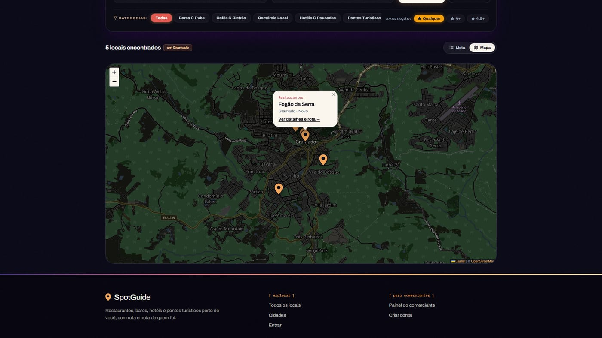

# SpotGuide

[](https://github.com/VITORHUGORDM/spotguide/actions/workflows/ci.yml)

Guia turístico e comercial do Brasil: encontre restaurantes, bares, hotéis e pontos turísticos em **qualquer cidade dos 27 estados**, filtre por preço, comodidades, nota e distância, e abra a rota no Google Maps. Comerciantes cadastram e gerenciam os próprios estabelecimentos e respondem às avaliações.

Projeto de portfólio em monorepo, com **web (Next.js)**, **API (Fastify + PostgreSQL)** e **app mobile (Expo)** compartilhando os mesmos contratos de tipos.


<table>
  <tr>
    <td width="50%"></td>
    <td width="50%"></td>
  </tr>
</table>

## O que dá para fazer

**Viajante**
- Buscar por estado e cidade (autocomplete com os **5.571 municípios do IBGE**) ou por proximidade ("perto de mim", raio de 5 a 50 km)
- Filtrar por categoria, nota mínima, faixa de preço (`$` a `$$$$`), comodidades (Wi-Fi, pets, estacionamento, acessibilidade...), "aberto agora", com fotos e verificados
- Ordenar por nota, mais avaliados, mais recentes, nome ou distância; ver em lista ou no mapa; paginação com "carregar mais"
- Todos os filtros ficam na URL: dá para compartilhar a busca e usar o botão voltar
- Navegar por `/estados` e `/estados/[estado]`, ver a página do local com horários, galeria, avaliações e rota no Google Maps
- Avaliar locais (uma avaliação por usuário)

**Comerciante**
- Cadastro com CPF ou CNPJ validado (inclusive o **CNPJ alfanumérico** de 2026)
- Cadastrar e editar estabelecimentos: o CEP preenche o endereço automaticamente, com horários, preço, comodidades e upload de fotos
- Responder às avaliações dos clientes

## Decisões técnicas

| Tema | O que foi feito |
| :--- | :--- |
| **Contratos compartilhados** | Schemas Zod em `packages/contracts` validam API, web e mobile com os mesmos tipos. Validadores sem dependência (CPF, CNPJ, CEP, telefone, links, horários) rodam no navegador e na API |
| **Busca** | Uma consulta SQL só devolve a página e o total (`COUNT(*) OVER()`). Para distância, um retângulo de coordenadas usa o índice antes de calcular Haversine. "Aberto agora" considera o fuso de Brasília e horários que viram a meia-noite |
| **Performance** | Home, cidades e estados são geradas no servidor e renovadas por ISR. API com gzip/brotli e `Cache-Control`. GSAP carregado sob demanda e hero sem esperar a API. Índices compostos, inclusive GIN para comodidades |
| **Segurança** | `.strict()` nos schemas contra mass assignment, guarda anti-IDOR por dono do local, rate limit por rota, Helmet, CORS restrito, bcrypt com 12 rounds, links só `http/https`, mensagem genérica no login contra enumeração de usuários |
| **Privacidade (LGPD)** | O CPF/CNPJ do comerciante nunca é guardado: só um HMAC (para impedir conta duplicada) e uma máscara como `***.982.247-**` |
| **Consistência** | Média de notas atualizada dentro de transação, com `UNIQUE(place_id, user_id)` |
| **Dados reais** | CEP via ViaCEP com fallback para BrasilAPI, cidade conferida contra a lista do IBGE e coordenadas dentro do Brasil |
| **SEO** | Metadados por página, JSON-LD, sitemap e canonical |

## Stack

| Camada | Tecnologias |
| :--- | :--- |
| **Web** | Next.js 15 (App Router), React 19, TypeScript, Tailwind CSS, Leaflet, GSAP |
| **API** | Node.js, Fastify, Prisma, PostgreSQL, JWT, Zod |
| **Mobile** | Expo 52, React Native, NativeWind, expo-location |
| **Monorepo** | pnpm workspaces e Turborepo |

## Estrutura

```
.
├── apps/
│   ├── api/        # Fastify + Prisma (módulos: auth, places, reviews, categories, photos, lookup)
│   ├── web/        # Next.js (busca, destinos, painel do comerciante)
│   └── mobile/     # Expo (feed com GPS e detalhes do local)
└── packages/
    ├── contracts/  # Schemas Zod e validadores compartilhados
    └── tsconfig/   # Configurações TypeScript
```

## Como rodar

Pré-requisitos: Node.js 20+, pnpm e PostgreSQL.

```bash
pnpm install

# configure o banco e os segredos
cp apps/api/.env.example apps/api/.env   # ajuste DATABASE_URL e os segredos JWT

pnpm --filter @guia/api db:migrate       # cria as tabelas
pnpm --filter @guia/api db:seed          # categorias e usuários de demonstração
pnpm --filter @guia/api db:seed:cidades  # 24 locais fictícios em 6 cidades

pnpm dev
```

| Serviço | Endereço |
| :--- | :--- |
| Web | http://localhost:3000 |
| API | http://localhost:3333 (`/health`) |
| Mobile | Expo Metro Bundler (Expo Go ou emulador) |

Para ver o desempenho real, use o build de produção: `pnpm build` e depois `pnpm --filter @guia/web start`.

Conta de comerciante para testar localmente (criada pelo seed, só para desenvolvimento): `comerciante@guiaturistico.com` / `Merchant@123456`.

## Testes

```bash
pnpm test
```

Roda o Vitest nos três pacotes (**69 testes**), sem precisar de banco:

| Pacote | O que cobre |
| :--- | :--- |
| `contracts` | CPF, CNPJ (numérico e alfanumérico), CEP, telefone, links, horários, coordenadas, senha, e os schemas de cadastro, local e busca |
| `api` | Base de municípios do IBGE, hash do documento e as rotas (validação, autenticação e formato dos erros), incluindo um teste de regressão para erros de validação que viravam 500 |
| `web` | Leitura e escrita dos filtros da busca na URL |

A cada push, o GitHub Actions confere os tipos, roda os testes e faz o build do site (`.github/workflows/ci.yml`).

## API (v1)

Base: `/api/v1`

| Método | Rota | Descrição | Acesso |
| :--- | :--- | :--- | :--- |
| `POST` | `/auth/register` | Cadastro de viajante ou comerciante | Público (rate limit) |
| `POST` | `/auth/login` | Login e emissão de JWT | Público (5 req/min) |
| `GET` | `/places` | Busca com filtros e total em `X-Total-Count` | Público |
| `GET` | `/places/slug/:slug` · `/places/id/:id` | Detalhes do local | Público |
| `GET` | `/places/cities` · `/places/states` · `/places/stats` | Autocomplete de cidades, estados com lugares e números da home | Público |
| `GET` | `/lookup/cep/:cep` | Endereço a partir do CEP | Público (rate limit) |
| `GET` | `/places/merchant/my-places` | Estabelecimentos do comerciante logado | Comerciante |
| `POST` | `/places` | Cadastrar estabelecimento | Comerciante |
| `PUT` · `DELETE` | `/places/:id` | Editar ou remover (apenas o dono) | Dono do local |
| `POST` | `/places/:id/photos` | Enviar foto (JPG, PNG ou WebP, até 5 MB) | Dono do local |
| `GET` · `POST` | `/reviews/place/:placeId` | Listar e enviar avaliações | Público · Autenticado |
| `POST` | `/reviews/:reviewId/reply` | Resposta do comerciante | Dono do local |

## Próximos passos

- Autenticação em dois fatores (TOTP) e confirmação de e-mail
- Edição de horários no painel do comerciante
- Testes de ponta a ponta (Playwright) e testes de integração com banco
- Geocodificação do endereço para preencher as coordenadas sozinho
